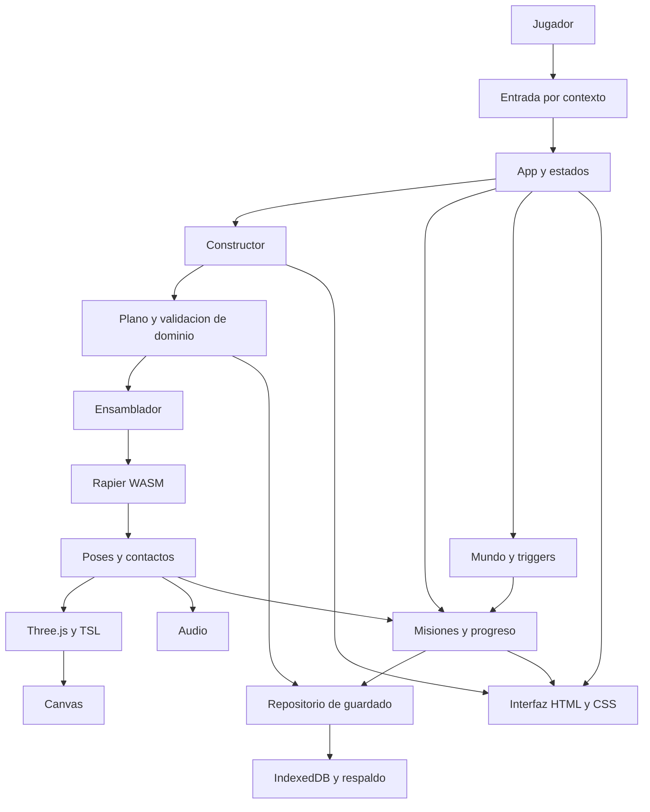

# Diagrama 01 — Arquitectura objetivo

Estado: propuesto. Las flechas muestran intercambio o dependencia; no código ya conectado.

El dominio de planos no conoce Rapier ni Three.js. El ensamblador crea recursos temporales. Física entrega poses; el renderizador no toma autoridad física. Misiones consumen eventos y actualizan datos de progreso.

Ver [arquitectura](../05-arquitectura-tecnica.md).
