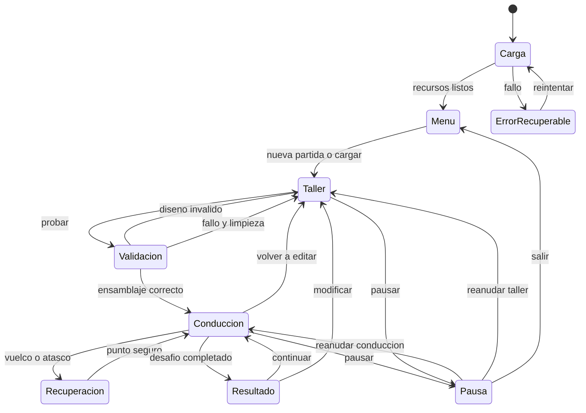

# Diagrama 02 — Estados del juego

Estado: propuesta. Cada transición debe limpiar entradas y recursos específicos.

Pausa recuerda el estado anterior; no elige arbitrariamente entre taller y conducción. El diagrama resume estados: diálogos modales pueden bloquear acciones sin crear una segunda simulación. Perder foco limpia entradas y detiene avance según política de pausa.

Ver [interfaz](../09-interfaz-y-controles.md).
