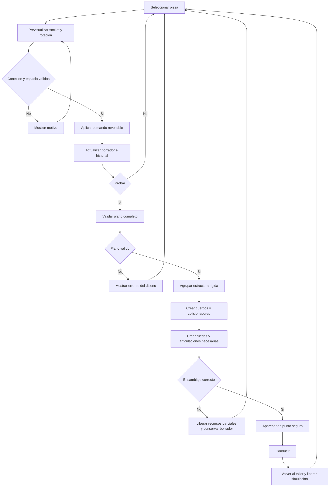

# Diagrama 03 — Edición y ensamblaje

Estado: contrato propuesto de F1/F2.

El historial se aplica a datos. Un ensamblaje fallido no debe dejar cuerpos huérfanos ni cambiar el plano guardado. El editor no recupera el diseño leyendo posiciones de mallas después de conducir.

Ver [constructor](../06-constructor-de-vehiculos.md).
