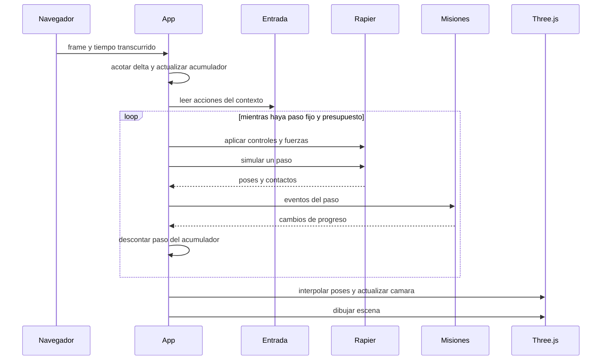

# Diagrama 04 — Paso fijo y representación

Estado: secuencia propuesta; el bucle actual del fork todavía es diferente.

Punto inicial: 60 Hz físicos, con límite de subpasos por definir y registrar en F0. Tras suspensión, evitar ponerse al día de forma ilimitada. Las misiones temporizadas usan tiempo de juego; en pausa no avanzan. Guardado se programa por eventos y no bloquea cada paso.

Ver [física](../07-fisicas-y-conduccion.md) y [pruebas](../12-pruebas-y-rendimiento.md).
