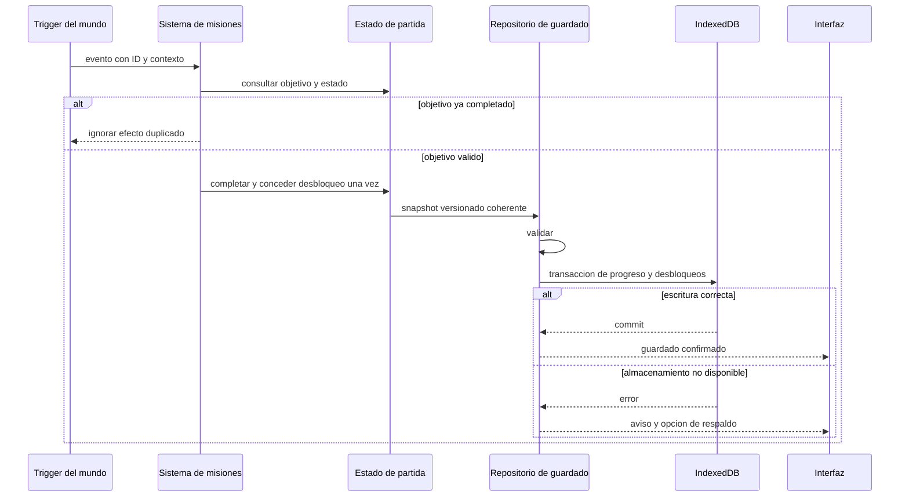

# Diagrama 05 — Progreso y persistencia

Estado: diseño propuesto.

La interfaz diferencia progreso en memoria y persistencia confirmada. Al cargar, validar y migrar antes de sustituir la partida activa. Reintentar una escritura no debe duplicar la recompensa. No depender del cierre de pestaña para terminar una transacción.

Ver [datos](../11-datos-guardado-y-versionado.md).
