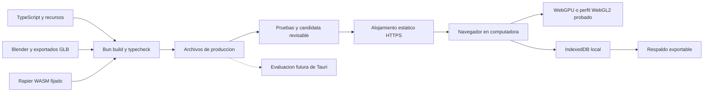

# Diagrama 06 — Desarrollo y distribución

Estado: pipeline propuesto, sin despliegue realizado.

No hay servidor de juego para la demo de un jugador. Bun prepara archivos; no necesita ejecutarse en la computadora del jugador. Tauri no está aprobado como sustituto nativo del renderizador.

Ver [publicación](../14-compilacion-y-publicacion.md).
