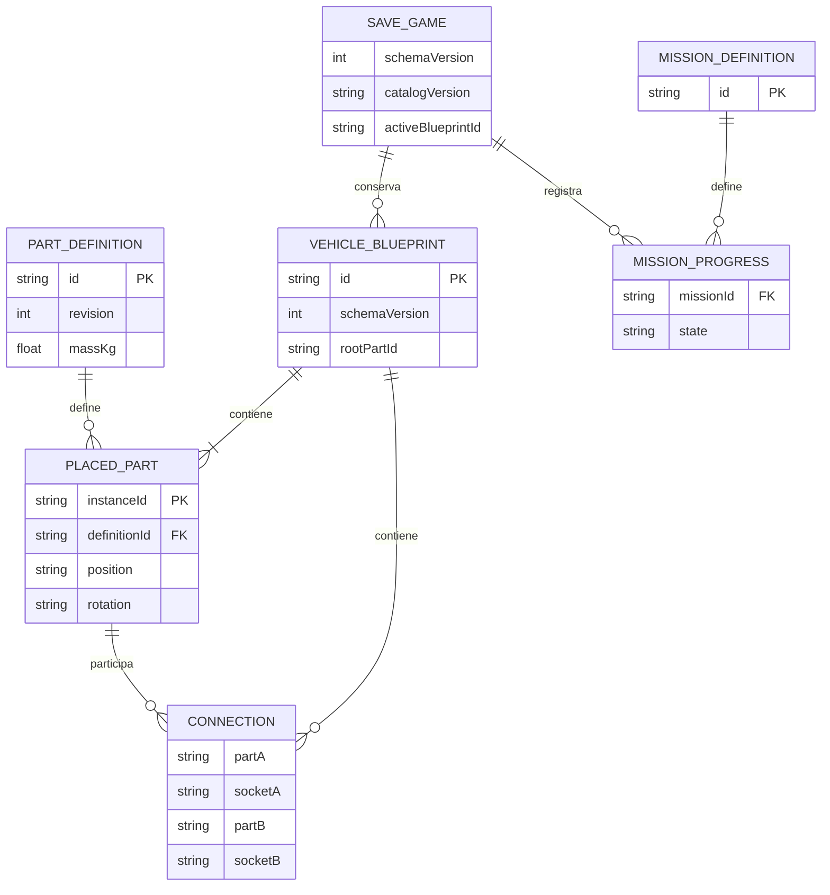

# Diagrama 07 — Entidades de datos

Estado: modelo conceptual propuesto; no es un esquema de base de datos implementado.

Posición y rotación se muestran como campos conceptuales; en el contrato JSON son arrays numéricos. Una conexión siempre tiene dos extremos, cada uno con pieza y socket. La cardinalidad conceptual no sustituye la validación de conectividad, raíz única y ocupación de conectores.

Ver [contratos](../11-datos-guardado-y-versionado.md).
